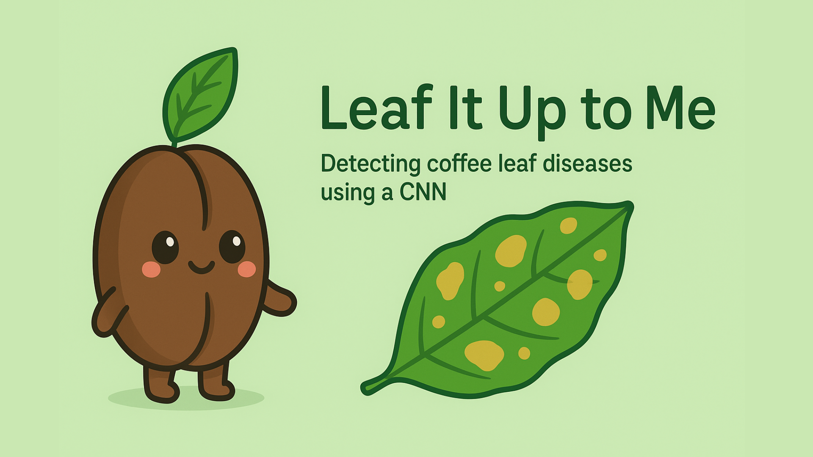
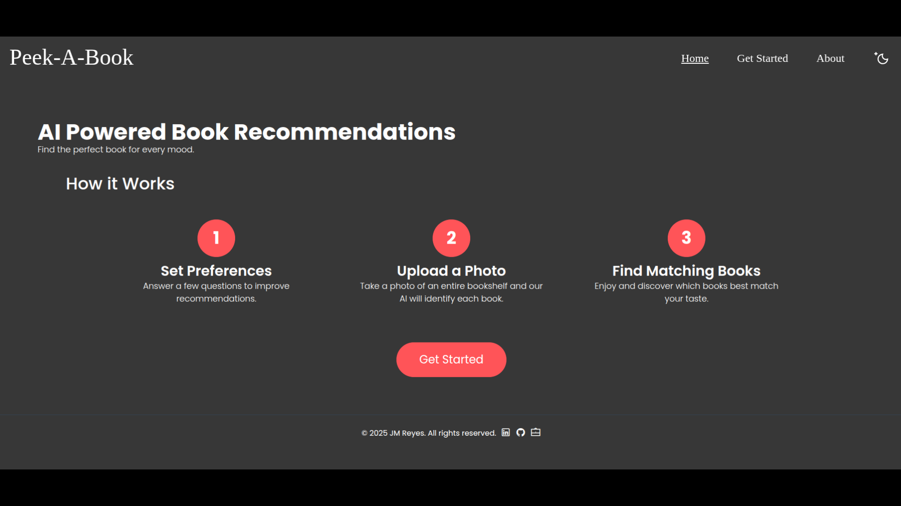
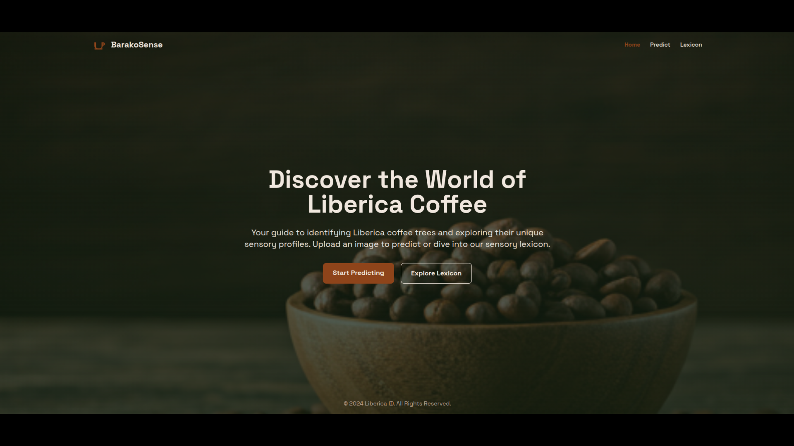
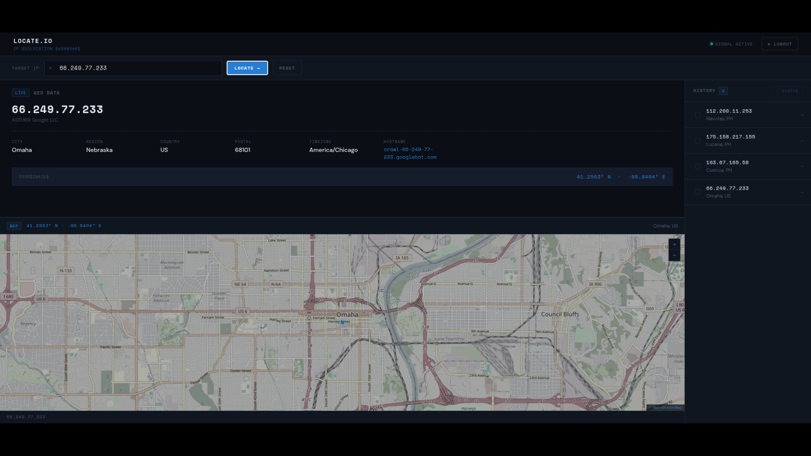

# Hi, I'm John Michael R. Reyes!

  

  <strong>Software Developer | Data Analyst @ CHED ROIV | AI/ML Enthusiast</strong>
   
  Building software and intelligent systems that solve real-world problems.

  <code>𝓒'𝓮𝓼𝓽 𝓮𝓷 𝓯𝓪𝓲𝓼𝓪𝓷𝓽 𝓷'𝓲𝓶𝓹𝓸𝓻𝓽𝓮 𝓺𝓾𝓸𝓲 𝓺𝓾𝓸𝓷 𝓭𝓮𝓿𝓲𝓮𝓷𝓽 𝓷'𝓲𝓶𝓹𝓸𝓻𝓽𝓮 𝓺𝓾𝓲</code>

  

## About Me

I'm a **Cum Laude Computer Science graduate from National University–Lipa**, currently working as a **Project Technical Staff I (Data Analyst) at CHED Regional Office IV-A**.

My current work primarily revolves around **data processing, analysis, and reporting for the Local Graduate Studies Scholarships (LGSS)**, where I apply my background in data science to help transform information into meaningful insights.

Beyond my professional responsibilities, I'm passionate about **software development, artificial intelligence, and machine learning**. I enjoy building applications, experimenting with new technologies, and developing intelligent systems that address practical, real-world problems. From full-stack applications to deep learning models and NLP-based solutions, I enjoy exploring how technology can make things better.

I'm a firm believer in continuous learning, building things one step at a time, and occasionally spending six hours fixing a bug that turned out to be a missing semicolon. Still learning, still building, and definitely still debugging.

---

## Languages and Tools

**Languages**

  
  
  
  

**Frontend Development**

  
  
  
  

**Backend and Authentication**

  
  
  

**AI and Data Science**

  
  
  
  
  

**Databases**

  
  
  

**Tools and Infrastructure**

  
  
  

---

## Featured Projects

  <table>
    <tr>
      <td align="center" width="33%">
        
         
        <strong>LAYA: Legal Aid AI</strong>
      </td>
      <td align="center" width="33%">
        
         
        <strong>NPKnows</strong>
      </td>
      <td align="center" width="33%">
        
         
        <strong>iPaws</strong>
      </td>
    </tr>
    <tr>
      <td align="center" width="33%">
        
         
        <strong>Leaf it Up to Me</strong>
      </td>
      <td align="center" width="33%">
        
         
        <strong>ArcadeHub</strong>
      </td>
      <td align="center" width="33%">
        
         
        <strong>NU Lipa Smart Admission</strong>
      </td>
    </tr>
    <tr>
      <td align="center" width="33%">
        
         
        <strong>Peek-A-Book</strong>
      </td>
      <td align="center" width="33%">
        
         
        <strong>BarakoSense</strong>
      </td>
      <td align="center" width="33%">
        
         
        <strong>Locate.io</strong>
      </td>
    </tr>
  </table>

  
<strong>More Projects</strong>

  - [Notes App - React and Django](https://github.com/itzjmbruhhh/notes-app-v2)
  - [Fitgirl Batch Downloader](https://github.com/itzjmbruhhh/fitgirl_batch_downloader)
  - [CNN Models Trained](https://github.com/itzjmbruhhh/CNN_Projects)
  - [Semantic Book Recommender - Python, Transformers, LangChain, Gradio](https://github.com/itzjmbruhhh/llm-book-recommender)

---

## Research and Publications

**Leaf-Based Health Assessment using CNN for NPK Deficiency Detection and IoT for Soil Analysis**

- Published in IEEE, 2026.
- Research focused on applying Convolutional Neural Networks (CNNs) for plant health assessment and integrating IoT for soil analysis.
- Explored deep learning approaches for detecting nutrient deficiencies in plants.

[Read the publication on IEEE Xplore](https://ieeexplore.ieee.org/document/11533893/)

---

## GitHub Statistics

  
  &nbsp;&nbsp;
  

  

---

## Certifications

<table align="center">
  <tr>
    <td align="center" width="33%">
      <a href="https://www.certiport.com/portal/Pages/PrintTranscriptInfo.aspx?action=Cert&id=471&cvid=gJa16edaw0zmiq6bgXDudw==">
        
         
        <strong>Python IT Specialist</strong>
         
        Certiport
      </a>
    </td>
    <td align="center" width="33%">
      <a href="https://www.certiport.com/portal/Pages/PrintTranscriptInfo.aspx?action=Cert&id=447&cvid=53MwZ6dvm6ZlxZr9m/osvg==">
        
         
        <strong>IC3 Digital Literacy</strong>
         
        Global Standard Six
      </a>
    </td>
    <td align="center" width="33%">
      <a href="https://www.freecodecamp.org/certification/itzjmbruhhh/machine-learning-with-python-v7">
        
         
        <strong>Machine Learning with Python</strong>
         
        freeCodeCamp
      </a>
    </td>
  </tr>
</table>

---

  

  <i>Still learning. Still building. Still debugging.</i>

